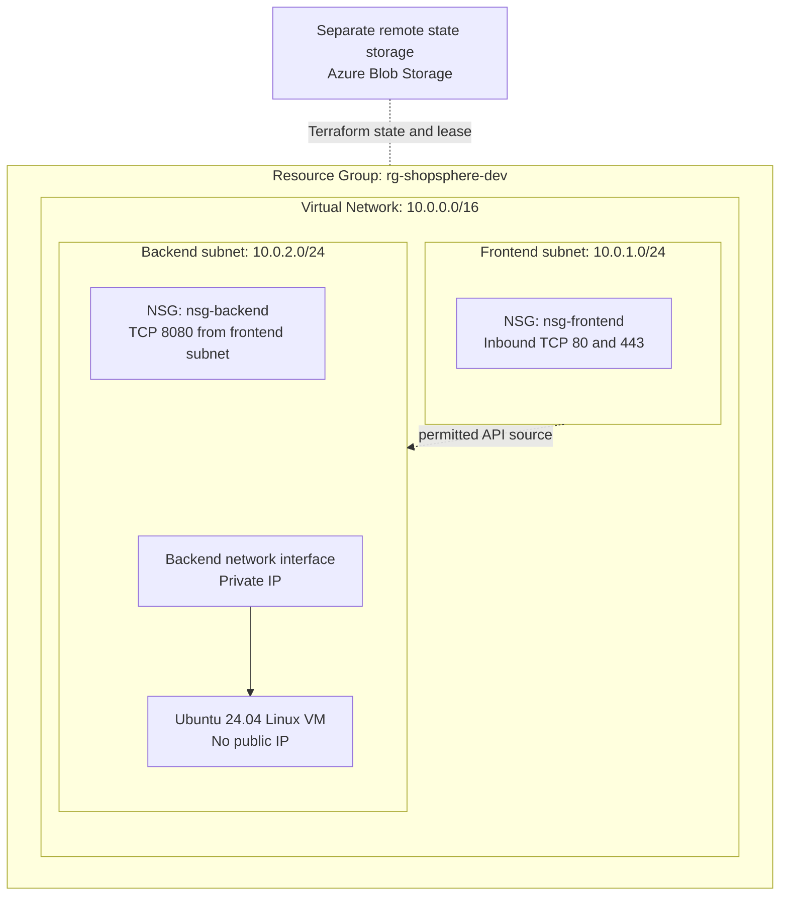

# ShopSphere infrastructure architecture

The Terraform root configuration describes the following Azure resources in Central India:

## Network rules

- Frontend subnet: `10.0.1.0/24`.
- Backend subnet: `10.0.2.0/24`.
- Frontend NSG: inbound TCP 80 and 443 are allowed from any IPv4 source.
- Backend NSG: inbound TCP 8080 is allowed only from `10.0.1.0/24`.
- The backend VM has no public IP. The configuration does not create a frontend VM, public IP, load balancer, NAT gateway, or application deployment.

## Remote state

Terraform state is stored in an Azure Blob container in a separate resource group. The backend configuration is supplied locally through `backend.hcl`; the actual storage account details are intentionally not included in this repository.
